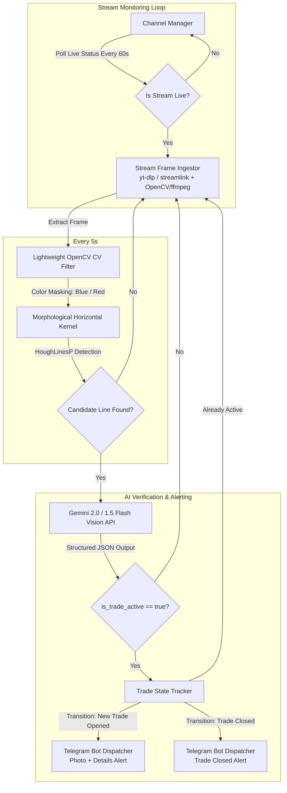

# YouTube Live Stream Trade Monitoring Bot

An automated bot designed to monitor live trading YouTube streams, extract live frames every 5 seconds, filter candidate frames using lightweight OpenCV horizontal line and color detection (Blue for Buy, Red for Sell), verify trades using Gemini Vision AI (with structured extraction), and send real-time Telegram alerts with photo attachments upon trade entry and exit.

## System Architecture



---

## Key Credentials Needed

- `GEMINI_API_KEY`: From Google AI Studio (Free/Pay-as-you-go).
- `TELEGRAM_BOT_TOKEN`: From Telegram `@BotFather`.
- `TELEGRAM_CHAT_ID`: Your personal Telegram user ID or group/channel chat ID.

---

## Project Structure

```
d:\projects\bot_agy\
├── .env.example              # Template for API keys and Telegram credentials
├── config.yaml               # Configurable channel URLs, polling intervals & CV thresholds
├── requirements.txt          # Python dependencies (opencv-python, google-genai, yt-dlp, streamlink, python-telegram-bot, etc.)
├── main.py                   # CLI entrypoint & async orchestrator
├── src/
│   ├── __init__.py
│   ├── config.py             # Configuration loader and dataclasses
│   ├── stream_manager.py     # YouTube live status checker & frame grabber via yt-dlp/streamlink
│   ├── cv_filter.py          # OpenCV Blue/Red horizontal line & position marker detector
│   ├── vision_verifier.py    # Gemini Vision API integration with structured JSON output schema
│   ├── state_tracker.py      # Trade state manager (handles trade open, active, and close transitions)
│   └── notifier.py           # Telegram notification sender (message + image attachment)
└── tests/
    ├── __init__.py
    └── test_cv_filter.py     # Synthetic & sample frame testing for line detection
```

---

## Component Breakdown

### 1. `requirements.txt`
Dependencies:
- `google-genai`: Official Google GenAI SDK for Gemini 2.0 Flash / 1.5 Flash
- `opencv-python-headless`: Fast computer vision without GUI overhead
- `numpy`: Image array processing
- `yt-dlp`: Reliable YouTube stream metadata and HLS/DASH manifest resolver
- `streamlink`: High-throughput live stream segment reader
- `python-telegram-bot` / `aiohttp`: Telegram Bot API integration
- `pydantic`: Structured validation for configuration and Gemini JSON responses
- `pyyaml`, `python-dotenv`: Configuration and environment loading
- `pillow`: Image handling

### 2. `config.yaml` & `src/config.py`
Configuration schema containing:
- Channels to monitor (list of YouTube channel/live URLs and friendly trader names)
- Capture settings (`frame_interval_seconds: 5`, `live_poll_interval_seconds: 60`)
- CV Detection settings (`min_line_length_ratio`, `blue_hsv_ranges`, `red_hsv_ranges`, `roi_crop`)
- AI settings (`model_name: "gemini-2.0-flash"`, `confidence_threshold: 0.7`)
- Telegram alert settings (include screenshot: true, caption format)

### 3. `src/stream_manager.py`
- Resolves YouTube channel `/live` URLs to direct HLS live stream URLs using `yt-dlp`.
- Detects if stream is currently live or offline.
- Captures fresh frames asynchronously every 5 seconds using `OpenCV` / `ffmpeg` video stream capture without saving unnecessary intermediate video files.

### 4. `src/cv_filter.py`
- Fast image pre-filter:
  1. Optional ROI (region of interest) masking (focusing on the main chart area).
  2. HSV color thresholding specifically for Blue hues (Buy / Long position lines) and Red hues (Sell / Short position lines).
  3. Morphological horizontal line structuring element kernel (`cv2.getStructuringElement(cv2.MORPH_RECT, (w, 1))`).
  4. `cv2.HoughLinesP` to detect horizontal segments meeting minimum length threshold.
  5. Returns boolean `candidate_found` and diagnostic metadata.

### 5. `src/vision_verifier.py`
- Formulates a multimodal prompt to Gemini 2.0 Flash / 1.5 Flash passing the candidate frame.
- Enforces strict JSON Schema response:
  ```json
  {
    "is_trade_active": true,
    "direction": "BUY", // "BUY", "SELL", or "NONE"
    "instrument": "NIFTY / BTC / EURUSD",
    "entry_or_pnl": "+$1,250",
    "confidence": 0.95,
    "reasoning": "Detected open long position horizontal line with green/blue profit zone."
  }
  ```

### 6. `src/state_tracker.py`
- Maintains per-channel state machine (`IDLE` -> `ACTIVE_TRADE` -> `CLOSED_TRADE`).
- Detects state transitions:
  - **NEW_TRADE**: Fires instant alert with screenshot.
  - **STILL_ACTIVE**: Suppresses repetitive spam alerts.
  - **TRADE_CLOSED**: Detects when horizontal line / trade disappears and sends exit notification.

### 7. `src/notifier.py`
- Asynchronous Telegram bot dispatcher.
- Sends formatted markdown message:
  ```
  🚨 TRADE DETECTED: [Trader Name]
  📊 Instrument: NIFTY 50
  📈 Direction: BUY (Long)
  💰 Details: Entry line visible
  ⏰ Timestamp: 2026-08-15 18:30:00 IST
  🔗 Stream: [YouTube Live Link]
  ```
- Attaches the captured chart frame directly to the Telegram message.

### 8. `main.py`
- Orchestrates concurrent async monitoring loops for all configured channels.
- Handles graceful shutdown (`Ctrl+C` / SIGINT / SIGTERM).

---

## Verification Plan

### Automated Tests
1. **CV Filter Unit Test**:
   - Run `python -m unittest tests/test_cv_filter.py` with synthetic chart images (images with blue horizontal lines, red horizontal lines, blank charts, and noisy background images) to verify line detection accuracy and threshold behavior.

2. **Gemini Vision Verification Test**:
   - Standalone test script to send a sample chart image to Gemini and verify structured JSON schema parsing.

3. **Telegram Dispatch Test**:
   - Verify Telegram bot connectivity and test photo dispatch using a dummy test frame.

### Manual Verification
1. Run `python main.py` against sample YouTube live channels (or recorded live video URLs for offline testing) and verify end-to-end frame capture, detection, and logging output.

### 9. Bounded test-mode hardening
- Keep `--test-minutes MINUTES` as an explicit opt-in that runs real monitoring for a bounded duration and then exits cleanly.
- Run Telegram and Gemini credential/model preflight checks before starting monitor tasks; fail closed if either provider check fails.
- Treat a monitor that fails before shutdown as fatal, while treating a monitor that returns because the test timer set the shared stop event as a normal shutdown.
- Always close monitor tasks, stream managers, Telegram sessions, and Gemini clients on success or failure.

### 10. Recorded-livestream offline benchmark

- Add a standalone CLI that accepts a downloaded local video and reuses the production
  `CaptureConfig` sampling interval and `CVFilter`/`CVFilterConfig` candidate decision.
- Extract one frame at each configured interval across the complete recording, starting at
  timestamp zero and never calling Gemini, Telegram, or loading their credentials.
- Emit a machine-readable JSON report with source metadata, total sampled frames, frames that
  would be sent to Gemini, frames not flagged, both percentages, color breakdown, elapsed
  processing time, and effective throughput.
- Fail clearly for missing/unreadable/empty videos and invalid configuration or intervals.
- Cover sampling/counting, candidate aggregation, percentage math, and failure cases with tests;
  document an exact local command for a downloaded YouTube recording.
- Document the exact 5-minute and 10-minute commands.
- Add deterministic tests for timer completion, monitor failure propagation, provider preflight failure, cleanup, CLI duration validation, and the shutdown race at the timer boundary. Tests must mock providers and must not read `.env` or make live network calls.
